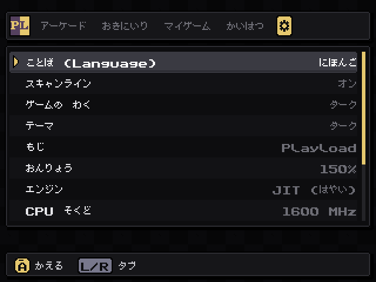
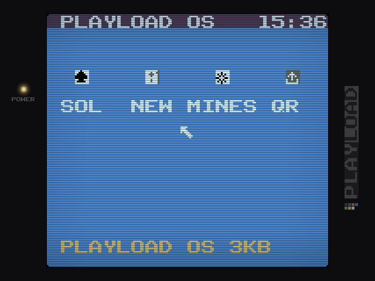
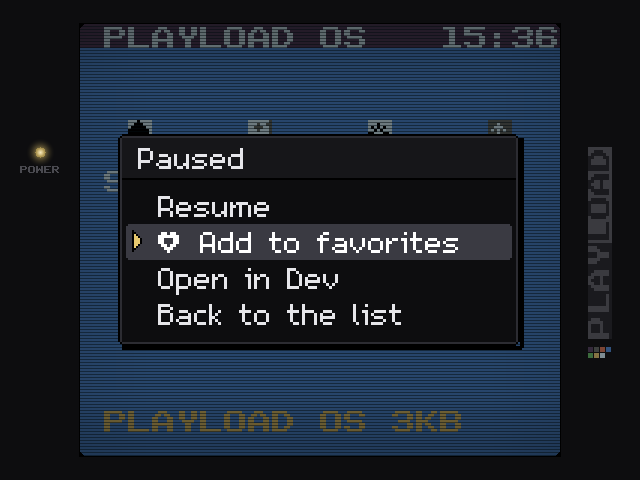
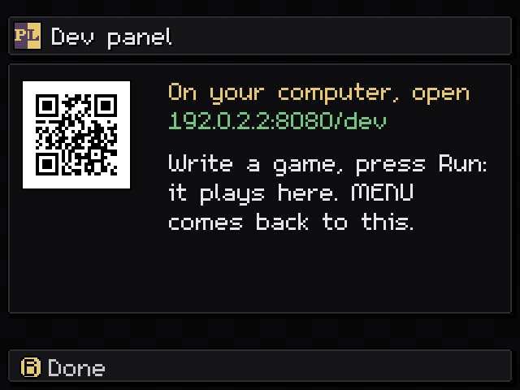

# Playload for Miyoo

[English](README.md) · **日本語**

[Playload](https://kitao.dev/playload/) は Takashi Kitao さんによる小さなゲームエンジンです。160×144、8 色、
3 チャンネルの音源で、ゲームがまるごと 1 本のリンクに収まります。これはそのゲームを Miyoo Mini シリーズで
遊べるようにした非公式の移植版です。PC で書いたコードをそのまま本体で動かすこともできます。

 
 

- **アーケード**: Playload 公式アーケードのゲームを収録。Wi-Fi があれば新作を自動で確認します。
- **お気に入り**(ゲームの上で Y)と**マイゲーム**(QR コードを読み取って、スマホから Playload のリンクを送信)。
- **開発パネル**: Miyoo に表示されるアドレスを同じ Wi-Fi 上のブラウザで開き、ゲームを書いて「Miyoo で実行」を押すと
  本体で動きます。ポーズメニューの「かいはつで ひらく」で、遊んでいるゲームのコードをエディタに読み込めます。
  Kitao さんのサンプルも入っています。
- スキャンライン、ゲームを囲むフレーム、7 種類のテーマ、英語と日本語。
- JavaScript エンジンは 2 つ: JIT 付きの JavaScriptCore(標準、約 2 倍速い)と、予備の QuickJS。

## 対応機種

SSD202D 搭載の Miyoo シリーズ共通のビルドです。**実機で動作を確認したのは Onion OS の Mini Plus だけ**で、
ほかは未確認です。

| 機種 | 画面 | 状況 |
| --- | --- | --- |
| Miyoo Mini Plus(Onion OS 4.2 以降) | 640×480 | 動作確認済み |
| Miyoo Mini v1–v3 | 640×480 | 未確認 |
| Miyoo Mini v4、Mini Flip | 752×560 | 未確認 |
| spruceOS、sprigUI | | 未確認 |

アーケードの更新、スマホからの送信、開発パネルには Wi-Fi が必要です(Mini Plus、Mini Flip)。
Wi-Fi がなくても収録済みのゲームは遊べます。

ほとんどのゲームはフルスピードで動きます。一部の 3D ゲーム(一覧で「おもい」と表示)は、1 フレームあたりの
計算量がこの CPU には多すぎます。

## インストール

[Releases](../../releases) から `Playload-Miyoo-vX.Y.zip` をダウンロードし、中の `App` フォルダを SD カードの
ルートにコピー(フォルダを統合)して、アプリ一覧から **Playload** を開いてください。

## 操作

| ボタン | 一覧 | ゲーム中 |
| --- | --- | --- |
| 十字キー | 上下で選択、左右でページ送り | Playload の上下左右 |
| A | 遊ぶ / 設定を変える | A |
| B | 戻る | B |
| X | アーケード: 更新 · お気に入り: 外す · マイゲーム: 削除 | A(もう 1 つ) |
| Y | お気に入りに追加 / 解除 | B(もう 1 つ) |
| L / R | タブ切り替え | |
| START | | ポーズメニュー(続ける、お気に入り、開発で開く、一覧に戻る) |
| SELECT | | スキャンラインのオン / オフ |
| MENU | 終了 | 一覧に戻る |

## 日本語について

「せってい」の「ことば (Language)」で切り替えます。Playload の 8×8 文字にはかながあり漢字がないため、
Miyoo 本体の表示は昔の 8 ビットゲームのように、かなの分かち書きです。開発パネルのページとスマホ用のページは
漢字まじりの日本語です。

翻訳は AI によるもので、まだ日本語話者のチェックを受けていません。おかしな表現があれば、Issue や
プルリクエストで教えていただけるとうれしいです。

## 仕組みとビルド

[英語の README](README.md#how-it-works) をご覧ください。

## クレジット

- Playload 本体、エンジン、サンプル、アーケードの一覧: [Takashi Kitao](https://github.com/kitao/playload)(MIT)
- アーケードのゲーム: それぞれの作者(各ゲームの横に表示)
- Miyoo 版: [@0kCyb0rg](https://x.com/0kCyb0rg) · [okcyborg.com](https://okcyborg.com)
- [JavaScriptCore](https://webkit.org)(LGPL 2.1)、[QuickJS-ng](https://github.com/quickjs-ng/quickjs)(MIT)、[ICU](https://icu.unicode.org)、[curl](https://curl.se)
- フォント: Playload の 8×8 文字(美咲ゴシック、Unscii-8、Public Pixel)、Daniel Linssen さんの [m5x7](https://managore.itch.io/m5x7)
- パレット: DawnBringer さんの DB8

Miyoo 版のコードは MIT ライセンスです。同梱物はそれぞれのライセンスに従います([LICENSE](LICENSE) と
`App/Playload/licenses` を参照)。これは非公式の移植版で、Playload の作者とは関係ありません。
