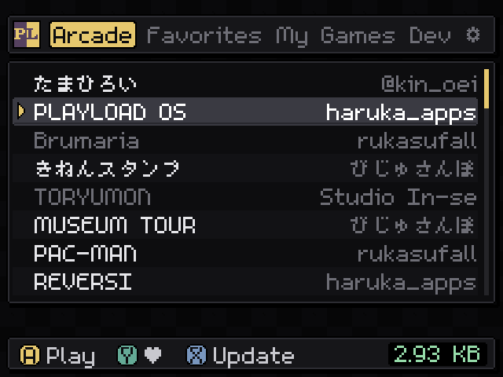
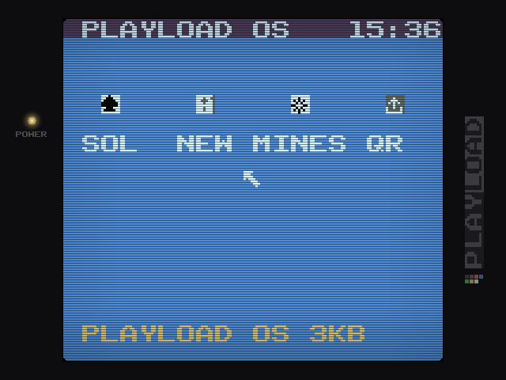
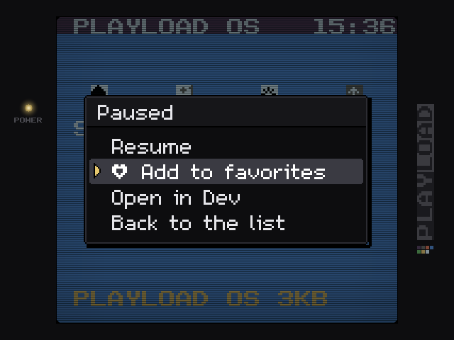
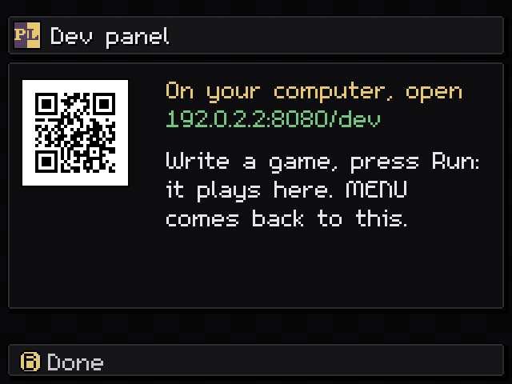
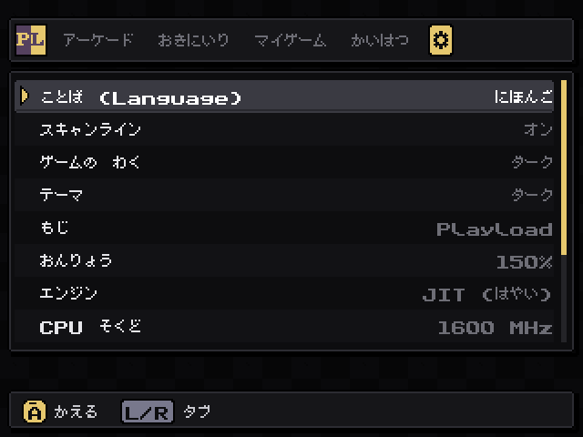

# Playload for Miyoo

**English** · [日本語](README.ja.md)

[Playload](https://kitao.dev/playload/) is Takashi Kitao's tiny game engine: 160×144, 8 colors, 3 sound
channels, and a whole game fits in a link. This runs those games on the Miyoo Mini family, and lets you write
new ones from your computer and see them on the handheld as you type.

 
 

- **Arcade**: the games from Playload's own Arcade, built in. With Wi-Fi the list updates itself when new ones are posted.
- **Favorites** (press Y on any game) and **My Games** (send a Playload link from your phone by scanning a QR code).
- **Dev panel**: the Miyoo shows an address; open it in a browser on the same Wi-Fi, write a game, press
  *Run on Miyoo*. "Open in Dev" in a game's pause menu puts that game's code in the editor. Kitao's examples are there to start from.
- Scanlines, a dark frame around the game, seven themes, English and Japanese.
- Two JavaScript engines: JavaScriptCore with its JIT (the default, about twice as fast) and QuickJS as the small fallback.

## Devices

One build for the SSD202D Miyoo family. **Only the Mini Plus on Onion OS has actually run it**; the rest
follows what worked for [ArchiveTV](https://github.com/mroxfordyazuka/ArchiveTV) and is untested.

| Device | Screen | Status |
| --- | --- | --- |
| Miyoo Mini Plus, Onion OS 4.2+ | 640×480 | works |
| Miyoo Mini v1–v3 | 640×480 | untested |
| Miyoo Mini v4, Mini Flip | 752×560 | untested |
| spruceOS, sprigUI | | untested |

Updating the Arcade, the phone page and the dev panel need Wi-Fi (Mini Plus, Mini Flip). Without it the
built-in games still play.

Most games run at full speed. A few 3D ones (marked HEAVY in the list) do more arithmetic per frame than this
CPU can manage in any engine.

## Install

Download `Playload-Miyoo-vX.Y.zip` from [Releases](../../releases), copy its `App` folder to the root of your
SD card (merge folders), and open **Playload** from Apps.

## Controls

| Button | In the list | In a game |
| --- | --- | --- |
| D-pad | up/down choose, left/right a page | Playload's four directions |
| A | play / change a setting | A |
| B | back | B |
| X | Arcade: update · Favorites: remove · My Games: delete | a second A |
| Y | add to / remove from Favorites | a second B |
| L / R | switch tab | |
| START | | pause menu: resume, favorite, open in Dev, back to the list |
| SELECT | | scanlines on / off |
| MENU | quit | back to the list |

## Japanese

Settings › Language. Playload's 8×8 characters have kana but no kanji, so on the Miyoo Japanese is written in
kana with spaces, the way 8-bit games did. The dev page and the phone page are in full Japanese. The
translation has not been checked by a native speaker yet; corrections are welcome.

## How it works

The app is a C program on SDL 1.2 that gives Playload's own JavaScript engine a screen,
buttons and a sound chip:

- `src/pl.c`: the main loop, settings, the frame, the pause menu
- `src/js_jsc.cpp`, `src/js_quickjs.c`: the two JavaScript engines behind one small interface (`src/js.h`)
- `patches.mjs`: speed patches applied to Playload's `engine.js` at build time (typed arrays, drawing done natively)
- `src/ay.c`: the sound chip, ported from Playload's `sound.js`
- `src/ui.c`, `js/menu.js`: the list and settings (the UI kit comes from ArchiveTV)
- `src/net.c`: the Arcade update (through the system's `curl`) and the small web server for the phone page and the dev panel
- `js/dev.html`: the dev page

Every bundled game was compared frame by frame against the original engine in Node on a PC; all but two draw
identical pictures (those two shuffle with `sort(random)`, which differs between JavaScript engines).

### Building

1. `node build.mjs <checkout of github.com/kitao/playload> out` makes `playload.js`, `menu.js`, `dev.html`,
   `games.json`, `examples.json` (copy them to `App/Playload/`) and `src/glyphs8.h`.
2. `TC=<miyoomini-toolchain> QJS=<quickjs-ng source> ./build_miyoo.sh` builds `playload` (QuickJS).
3. `./build_miyoo_jsc.sh` builds `playload-jit`. It needs JavaScriptCore and ICU for ARM: prebuilt in
   [jsc-miyoo](https://github.com/mroxfordyazuka/jsc-miyoo), or see `docs/REBUILDING-JIT.txt`.

`build_host.sh` makes a desktop build without SDL that renders screenshots and runs the tests in `test/`.

## Credits

- Playload, its engine, examples and the Arcade list: [Takashi Kitao](https://github.com/kitao/playload) (MIT)
- Arcade games: their authors, named next to each game
- Miyoo version: [@0kCyb0rg](https://x.com/0kCyb0rg) · [okcyborg.com](https://okcyborg.com)
- [JavaScriptCore](https://webkit.org) (LGPL 2.1), [QuickJS-ng](https://github.com/quickjs-ng/quickjs) (MIT), [ICU](https://icu.unicode.org), [curl](https://curl.se)
- Fonts: Playload's 8×8 characters (Misaki Gothic, Unscii-8, Public Pixel), [m5x7](https://managore.itch.io/m5x7) by Daniel Linssen
- Palette: DB8 by DawnBringer

The code of the Miyoo version is MIT licensed; bundled parts keep their own licenses (see [LICENSE](LICENSE)
and `App/Playload/licenses`). This is an unofficial port and is not affiliated with Playload's author.
